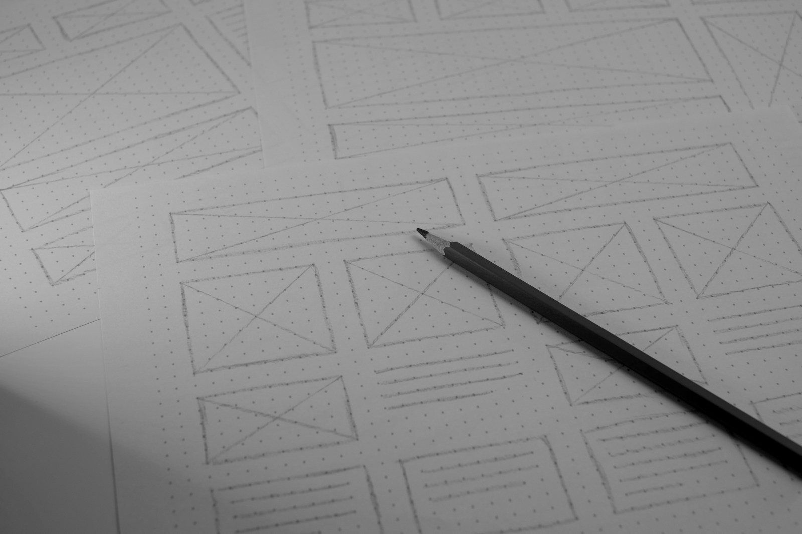
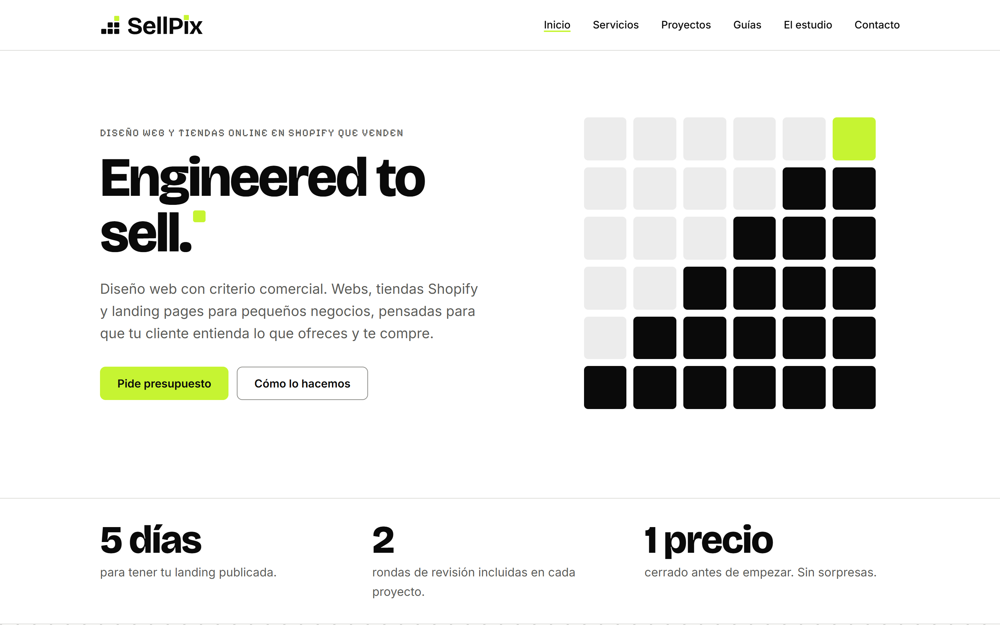
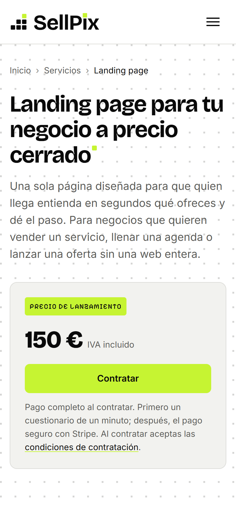

<!--
DOSSIER DE SELLPIX · texto fuente

Este archivo tiene todo el texto del dossier (8 páginas A4). Para regenerar el PDF:  npm run dossier
(la primera vez, npm install). El PDF sale en descargas/sellpix-dossier.pdf, la copia pública que enlaza Servicios.

Los PRECIOS, ALCANCES, PLAZOS Y EXTRAS no se escriben aquí: se leen de data/servicios.json, el mismo archivo que usa
la web. Si cambia un precio, se cambia allí y se regeneran la web (node scripts/precios.js) y el dossier.

MARCAS
  === Página N · tipo ===   Empieza una página. Tipos: portada y cierre (fondo negro), normal (blanco), alterna (gris claro).
  [logo]                    Logotipo de SellPix en blanco.
  [espacio]                 Hueco flexible que empuja lo siguiente hacia abajo (portada y cierre).
  [antetítulo] Texto        Antetítulo en Pixelify Sans y mayúsculas.
  # Texto                   Titular grande (portada y cierre). Una barra invertida al final de línea = salto de línea.
  ## Texto                  Titular de página.
  ### Texto                 Titular pequeño (de columna o de pregunta).
  [entradilla] Texto        Texto de entrada grande.
  [nota] Texto              Nota pequeña en gris.
  [cita] Texto              Cita destacada.
  Texto                     Párrafo normal (una línea = un párrafo).
  - Texto                   Elemento de lista con el píxel lima.
  **texto**                 Negrita.
  [texto](enlace)           Enlace (en el PDF se puede pulsar).
  {{id.campo}}              Dato de data/servicios.json: precio (importe con el símbolo del euro), precio-mes (importe al mes), dias («10»),
                            plazo («10 días hábiles»), alcance… Los id son landing, web-corporativa,
                            tienda-online-shopify, mantenimiento-web, mantenimiento-wordpress,
                            mantenimiento-woocommerce, pagina-adicional, revision-extra y entrega-urgente.
  ^N                        Tras una marca, separación superior con el token --space-N (por ejemplo [nota]^3).

BLOQUES (se cierran con :::fin)
  :::columnas               Dos columnas. :::otra pasa a la segunda.
  :::tarjeta                Tarjeta con borde (dentro de una columna).
  :::tarjetas               Rejilla de tarjetas de dos en dos: cada «### Título» con su párrafo es una tarjeta.
  :::pasos                  Pasos numerados en fila: «1. Título | Texto».
  :::tabla                  Tabla de tres columnas con filas «Celda | Celda | Celda»; la primera fila es la cabecera.
  :::fotos                  Dos fotos en columnas: «».
  :::capturas               Captura de escritorio y de móvil, una al lado de otra (mismo formato que :::fotos).
  :::preguntas              Preguntas en dos columnas: «### Pregunta» y su respuesta. :::otra pasa a la segunda.
  :::pie-portada            Contacto de la portada (cada línea, un renglón) y la escalera de píxeles.
  :::pie-cierre             Datos de contacto del cierre («Clave: valor») y la escalera de píxeles.
  [foto panorámica]     Foto a todo el ancho, recortada a 16:7.

DATOS (sin texto: todo sale de data/servicios.json)
  [[paquetes: id, id, id]]  Tarjetas de los paquetes: etiqueta, precio, alcance, plazo y lo que incluyen.
  [[mantenimientos: id, id, id]]  Tarjetas de los planes de mantenimiento.

El pie de cada página (lema o «SellPix · sellpix.es» y el número) lo pone la plantilla.
-->

=== Página 1 · portada ===
[logo]
[espacio]
[antetítulo] Dossier · Diseño web con criterio comercial
# Webs que hacen \
el trabajo de vender.
[entradilla]^5 Landing pages, webs corporativas, tiendas Shopify y mantenimiento WordPress para pequeños negocios. Precio cerrado, entrega en días y una web que tu cliente entiende a la primera.
:::pie-portada
[hola@sellpix.es](mailto:hola@sellpix.es) · [sellpix.es](https://sellpix.es/)
Oviedo, Asturias · toda España, en remoto
:::fin

=== Página 2 · normal ===
[antetítulo] El estudio
## Venimos de vender, no de decorar.
:::columnas
SellPix nace de la venta. Antes de diseñar webs, su experiencia está en la dirección comercial: equipos, centros de ventas y, sobre todo, ver de cerca qué hace que un cliente compre o se vaya. Ese conocimiento es el punto de partida de cada web.
No diseñamos por estética. Diseñamos para que tu cliente entienda qué vendes, se fíe de ti y dé el paso: llamar, reservar, pedir presupuesto o comprar.
Trabajamos con herramientas de inteligencia artificial para ir más rápido en lo técnico y revisamos a mano cada detalle. Lo decimos abiertamente: esa combinación es la que permite entregar en días y a precio cerrado.
Con sede en Oviedo y clientes en toda España. Todo el proceso es en remoto: primer contacto y propuesta por email, reuniones por videollamada y teléfono una vez contratado.
:::otra
:::tarjeta
### Cómo trabajamos
- **El negocio primero.** Antes de diseñar, preguntas sobre lo que vendes, a quién y qué te diferencia.
- **Precio cerrado.** Lo ves antes de empezar y es el que pagas. Sin horas ni costes ocultos.
- **Rápido y revisado.** IA para lo repetitivo, revisión manual de todo.
- **Transparencia.** Si algo no encaja con tu proyecto, te lo decimos antes de empezar.
- **La web es tuya.** Dominio y cuentas a tu nombre, y una explicación para editarla sin tocar código.
:::fin
[cita] «Una web bonita que no vende es un folleto caro. Las nuestras se diseñan para que tu cliente dé el paso.»
:::fin

=== Página 3 · alterna ===
[antetítulo] Servicios
## Tres formatos, un precio cerrado cada uno.
[[paquetes: landing, web-corporativa, tienda-online-shopify]]
[[mantenimientos: mantenimiento-web, mantenimiento-wordpress, mantenimiento-woocommerce]]
[nota]^3 Los tres planes de mantenimiento: IVA incluido y sin permanencia; detalle en [sellpix.es/servicios/mantenimiento-wordpress/](https://sellpix.es/servicios/mantenimiento-wordpress/). Todos los paquetes se pagan completos al contratar, con tarjeta a través de Stripe o por transferencia. Extras: página adicional {{pagina-adicional.precio}} (web y tienda), revisión extra {{revision-extra.precio}} por ronda, entrega urgente {{entrega-urgente.precio}}; se presupuestan por escrito y se pagan antes de hacerlos. El plazo empieza a contar cuando tenemos tus materiales (textos, fotos y datos). Dominio y alojamiento van aparte, a tu nombre; te ayudamos a contratarlos. Detalle completo y condiciones en [sellpix.es/servicios](https://sellpix.es/servicios/) y [sellpix.es/condiciones](https://sellpix.es/condiciones/).

=== Página 4 · normal ===
[antetítulo] Cómo trabajamos
## De la primera conversación a la entrega, en cinco pasos.
:::pasos
1. Nos cuentas tu negocio | Por el formulario de la web o por email, y después en una videollamada. Qué vendes, a quién y qué quieres que haga la web.
2. Precio cerrado | Por email, en menos de 24 horas, con lo que incluye y el plazo. Si encaja, contratas desde la web o por transferencia.
3. Tus materiales | Textos, fotos y datos. Te decimos exactamente qué necesitamos y te ayudamos a prepararlo.
4. Diseño y revisión | Te enseñamos la web en un enlace privado y la ajustamos en dos rondas, por videollamada o por email.
5. Publicación | En tu dominio, con una explicación para que la edites tú. Si prefieres, mantenimiento mensual.
:::fin
:::columnas^7
### Qué necesitamos de ti
- Nombre comercial exacto y logotipo, si lo tienes.
- Datos del titular para el aviso legal: nombre o razón social, identificación fiscal, dirección, email.
- Teléfono, email y WhatsApp que atiendes de verdad.
- Textos que ya tengas y las preguntas que más te hacen tus clientes.
- Fotos tuyas, del local, del equipo y de tus productos, en tamaño original.
- Acceso al dominio, si ya lo tienes. Si no, lo compramos a tu nombre.
:::otra
### Qué te entrego
- La web publicada en tu dominio, con certificado de seguridad.
- Páginas legales adaptadas a tu negocio (aviso legal, privacidad, cookies).
- Textos, títulos y descripciones pensados para Google y para tu cliente.
- Web rápida, accesible y adaptada a móvil, comprobada con Lighthouse y pa11y antes de entregar.
- Una explicación, por videollamada, de cómo cambiar textos, fotos y horarios.
- Dominio, alojamiento y cuentas a tu nombre, no al nuestro.
:::fin

=== Página 5 · alterna ===
[antetítulo] Para qué sirve
## Tu web, tu mejor comercial.
[foto panorámica] 
Un buen comercial escucha, explica la oferta con las palabras del cliente, resuelve objeciones y pide la venta. Una web bien hecha hace lo mismo, a cualquier hora y con cualquier número de visitas a la vez. Para eso la diseñamos: no para que guste, sino para que venda.
:::tarjetas^4
### Atiende 24/7
Está abierta cuando tu negocio está cerrado. Responde a quien busca a las once de la noche o un domingo, con el mensaje que tú decides.
### Resuelve dudas antes de que pregunten
Qué incluye, cuánto cuesta, cuánto tarda, dónde estás. Las preguntas de cada semana, contestadas antes de que nadie tenga que escribir.
### Filtra y prepara al cliente
Quien te contacta ya sabe qué ofreces y a qué precio. Menos consultas que no encajan y más clientes con la decisión casi tomada.
### Cierra la venta o la cita
Cada pantalla lleva a una acción clara: llamar, reservar, pedir presupuesto o comprar. Sin rodeos y desde el móvil.
:::fin
[nota]^4 Fotografía de Avtar Singh en Unsplash.

=== Página 6 · normal ===
[antetítulo] Cómo creamos tu proyecto
## Cinco etapas, juntos.
Ni tú solo con un formulario ni nosotros solos con el editor. En cada etapa hay una parte que aportas tú y otra que aportamos nosotros.
:::tabla
Etapa | Tú aportas | SellPix aporta
**1 · Diagnóstico del negocio** | Tu negocio por email o videollamada; las preguntas de tus clientes; qué debe hacer la web. | Cuestionario corto, lectura comercial y propuesta con alcance, plazo y precio cerrado.
**2 · Estrategia y mensajes** | Logotipo, textos, fotos y datos; precios y lo que incluye cada servicio; tus correcciones a la estructura. | Estructura de la web, mensaje de cada pantalla, textos orientados a venta y lista exacta de lo que falta.
**3 · Diseño y desarrollo** | Disponibilidad por email para dudas; acceso al dominio. | Diseño propio y desarrollo; formulario, WhatsApp o citas online; comprobaciones de velocidad, accesibilidad y validación.
**4 · Revisión conjunta** | Tu revisión con la mirada de tu cliente; las correcciones de cada ronda, por escrito. | Dos rondas aplicadas y explicadas; revisión final de enlaces, formulario, móvil y legales.
**5 · Lanzamiento y mejora** | Difundirla y contarnos qué preguntan los visitantes. | Publicación con certificado, explicación para editarla, 30 días de corrección de errores nuestros y mantenimiento opcional.
:::fin
:::fotos^5

:::fin
[nota]^3 Fotografías de Vitalii Abakumov y Headway en Unsplash. Recorrido completo en [sellpix.es/proyectos/](https://sellpix.es/proyectos/)

=== Página 7 · alterna ===
[antetítulo] Lo que decimos, lo aplicamos
## La web de SellPix, hecha con el mismo método.
:::capturas

:::fin
[nota]^3 Sistema de diseño propio, tema claro y oscuro, páginas de producto con contratación online y verificación automática en cada publicación (validación de HTML, accesibilidad WCAG 2 AA y Lighthouse en móvil).
:::preguntas^4
### ¿Cuánto tardáis?
{{landing.dias}}, {{web-corporativa.dias}} o {{tienda-online-shopify.dias}} días hábiles según el formato, desde que tenemos tus materiales.
### ¿Y si no tengo textos ni fotos?
Te damos una lista concreta y te ayudamos a prepararlos. Con tus notas y fotos de móvil con buena luz se puede empezar.
### ¿Cómo y cuándo pago?
Pago completo al contratar, con tarjeta a través de Stripe o por transferencia. Lo que exceda el paquete se presupuesta antes de hacerlo.
:::otra
### ¿Dependo de vosotros después?
No. Dominio y cuentas van a tu nombre y te explicamos cómo editar la web. El mantenimiento es opcional.
### ¿Mantenéis webs que no hicisteis vosotros?
Sí, WordPress y WooCommerce desde {{mantenimiento-wordpress.precio-mes}}. Empezamos con una revisión inicial gratuita y, si la web no se puede mantener tal cual y no quieres el presupuesto de reparación, cancelamos la suscripción y te devolvemos el primer mes completo.
:::fin

=== Página 8 · cierre ===
[logo]
[espacio]
[antetítulo] ¿Hablamos?
# Cuéntanos qué vendes.
[entradilla]^5 Te respondemos por email en menos de 24 horas con una propuesta y un precio cerrado. Sin compromiso.
:::pie-cierre
Email: [hola@sellpix.es](mailto:hola@sellpix.es)
Web: [sellpix.es](https://sellpix.es/)
Contratar: [sellpix.es/servicios](https://sellpix.es/servicios/)
Cómo: Email, videollamada y teléfono una vez contratado
Dónde: Oviedo, Asturias · toda España, en remoto
:::fin
